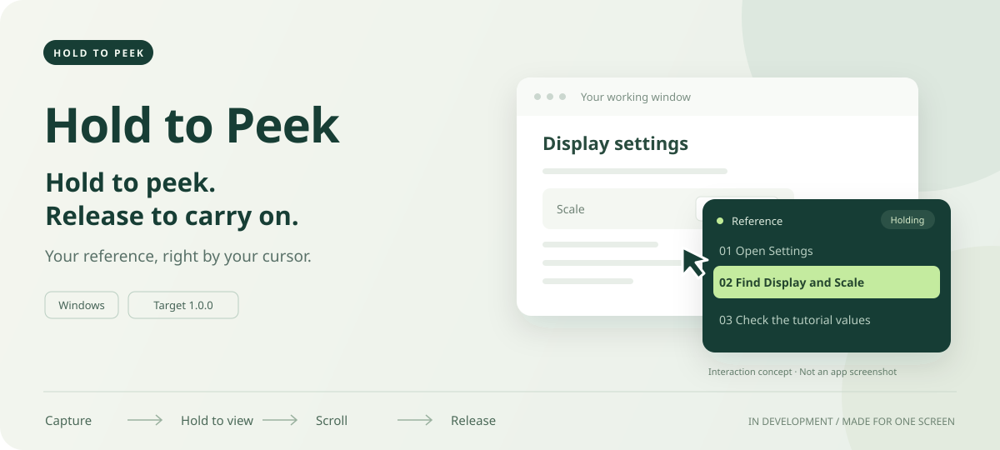
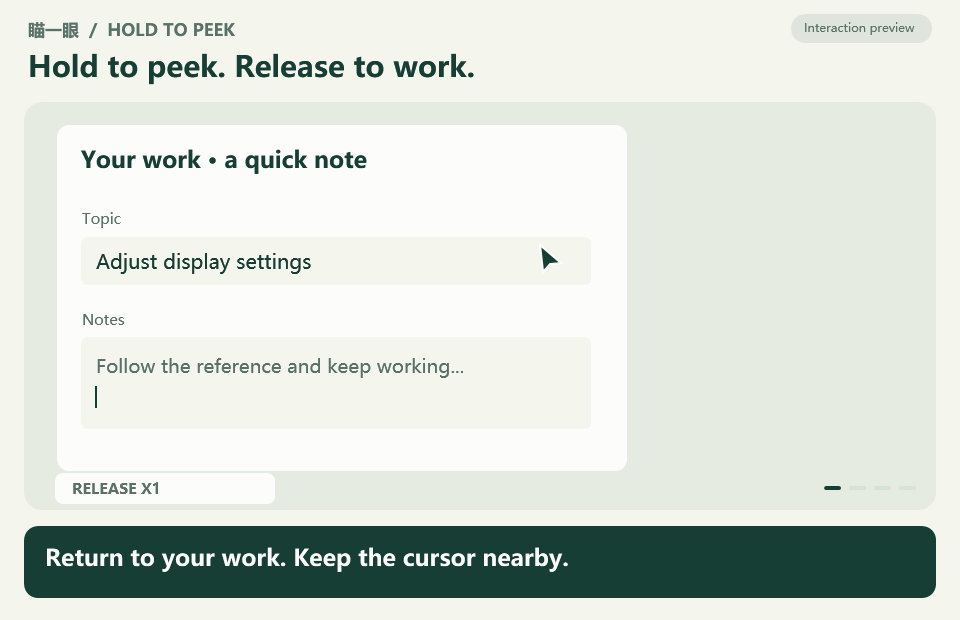
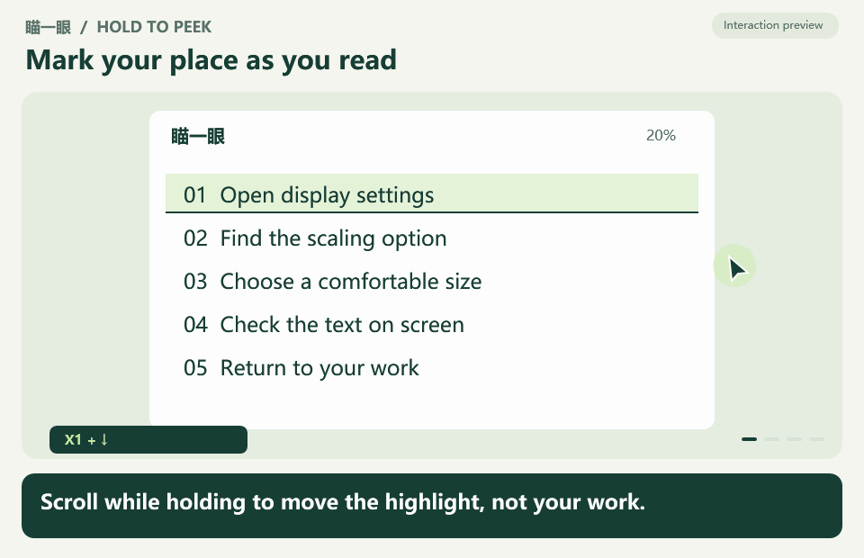

  

<a href="README.md">简体中文</a> · <b>English</b>

> Source update: 1.3.0 adds quick capture, custom shortcuts, and a separate guide. Downloads and demos below show the published 1.0.0 release. See the [changelog](docs/CHANGELOG.md).

<b>Keep your reference close, even with just one screen.</b> Hold to peek. Release to work. Pick up at the same line next time.

  
  
  
  

  <a href="#the-few-lines-you-need-right-by-your-cursor">Use cases</a> ·
  <a href="#four-actions-then-back-to-work">How it works</a> ·
  <a href="https://github.com/JackieYangon/hold-to-peek/releases/download/v1.0.0/hold-to-peek-1.0.0-win-x64.zip">Download v1.0.0</a> ·
  <a href="https://github.com/JackieYangon/hold-to-peek/issues">Feedback</a>

> The captioned GIFs below illustrate the interactions using sample content. They are not desktop recordings.

**[Download the portable Windows x64 app](https://github.com/JackieYangon/hold-to-peek/releases/download/v1.0.0/hold-to-peek-1.0.0-win-x64.zip)** · [Read the v1.0.0 release notes](https://github.com/JackieYangon/hold-to-peek/releases/tag/v1.0.0)

## The few lines you need, right by your cursor

You read five steps in a tutorial, switch to Settings, and immediately need to check step two again. Back to the browser, then back to Settings. A small task turns into a lot of window switching.

Hold to Peek is designed to bring that reference closer: **hold a mouse side button to see it beside your cursor; release to keep working.**

| What you are doing | What you want close by |
| --- | --- |
| Following a Windows settings tutorial | A short list of instructions |
| Filling out a form from a chat message | Names, addresses, and requirements |
| Entering shipping or order details | The small section you keep checking |
| Adjusting application settings | Option names and their values |

Made for the moments when you have one laptop screen and need to read while you work.

## Four actions, then back to work

Get started in four actions:

1. **Capture.** Choose “框选参考” (Capture reference) from the tray menu and select the area you need.
2. **Hold.** Return to your work and hold the trigger. Your reference appears beside the cursor without taking focus from the active window.
3. **Scroll.** Move the highlight to mark your place. The window underneath stays still.
4. **Release.** The reference disappears. Hold again to return to the same line.

**One screenshot. One highlight. One button within reach.**

| Action | What it does |
| --- | --- |
| Back mouse button, X1 | The default hold-to-peek trigger |
| Forward mouse button, X2 / keyboard F8 | Alternative triggers selectable in settings |
| Mouse wheel | Move the highlight by the configured line spacing |
| Shift + mouse wheel | Fine adjustment: one original-image pixel per notch |
| Esc | Cancel a capture or dismiss the current peek |
| Tray menu → “暂停” (Pause) | Restore the trigger button's normal function |

The highlight marks your reading position. It does not recognize text or identify the next instruction automatically. Capturing a new reference resets the position.

**Spacing feels off? Adjust it with your reference in view.** Settings lets you try the current screenshot and see the highlight change as you move the slider, without losing your reading position. If you start a capture from settings, Esc returns you there and keeps the existing reference.

## See it once, then try it

### Capture only what you need

Start a capture from the tray, drag around your reference, and release. Esc or right-click cancels while keeping the previous reference.

### Keep your place as you read

Scroll while holding the trigger to move the highlight. Hold Shift as well to fine-tune its position by one original-image pixel per notch.

### Adjust spacing without guessing

Move the slider while looking at the current reference, then try a few lines. The preview keeps your original reading position intact. Save when it feels right.

### No side button? Use F8

Select “键盘 F8” (Keyboard F8) in settings and save. Hold to view and release to hide, just like a mouse side button.

### Get your button back whenever you need it

Pause from the tray when you need the side button's normal forward or back action. Resume to return to the same reference and reading position.

## Get Hold to Peek

The current version is **1.0.0 for Windows x64**, a portable build with the .NET runtime included. No SDK installation is needed.

1. [Download the ZIP](https://github.com/JackieYangon/hold-to-peek/releases/download/v1.0.0/hold-to-peek-1.0.0-win-x64.zip) and extract it to a folder you want to keep.
2. Open `HoldToPeek.exe`, choose a trigger, and select “框选参考” (Capture reference).
3. To exit, right-click the system tray icon and choose “退出” (Exit).

[Release notes and SHA256 checksum](https://github.com/JackieYangon/hold-to-peek/releases/tag/v1.0.0)

If this is the tool you have been looking for, leave a **Star** or tell us in [Issues](https://github.com/JackieYangon/hold-to-peek/issues) which two windows you keep switching between.

## Before you use it

- **Your screenshot stays in local memory.** It is not uploaded or automatically saved to disk. The current screenshot and reading position remain available during the session and are cleared when you exit.
- **No mouse side buttons?** Select F8 in settings: hold to view, release to hide.
- **Initial target: Windows 11 x64, regular desktop apps, and a single screen.** Windows 10, ARM64, multiple monitors, elevated windows, and games still need validation. Secure desktops and exclusive fullscreen apps are not guaranteed to work.
- **The app interface is currently in Simplified Chinese.** This English guide includes the relevant menu labels.

[Development notes (Chinese)](docs/BUILD.md)

## License

This project is licensed under the [MIT License](LICENSE).
