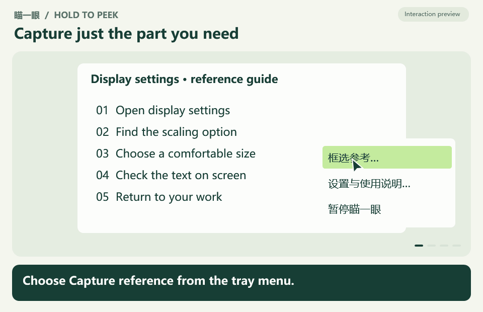
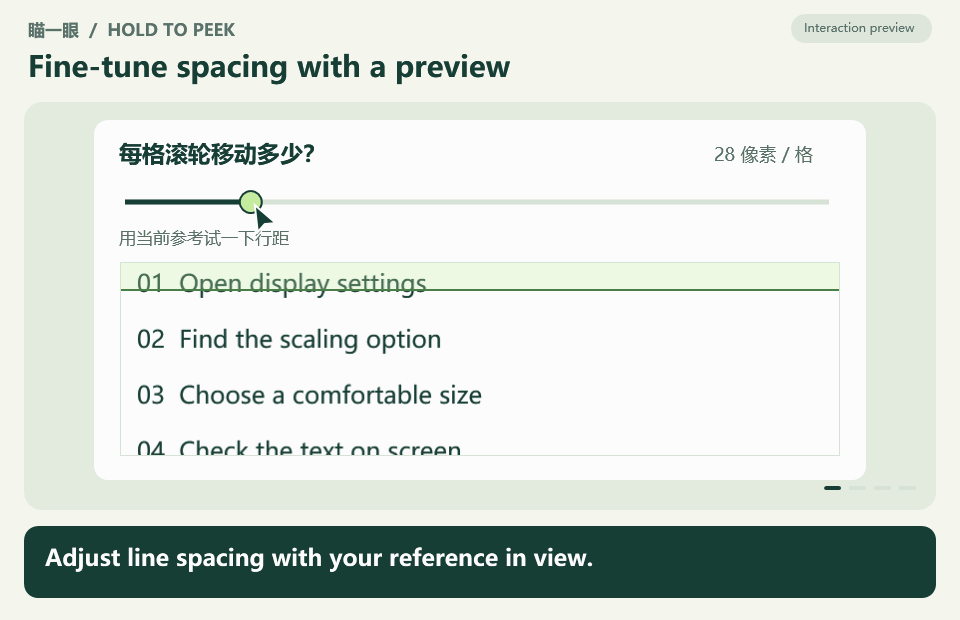
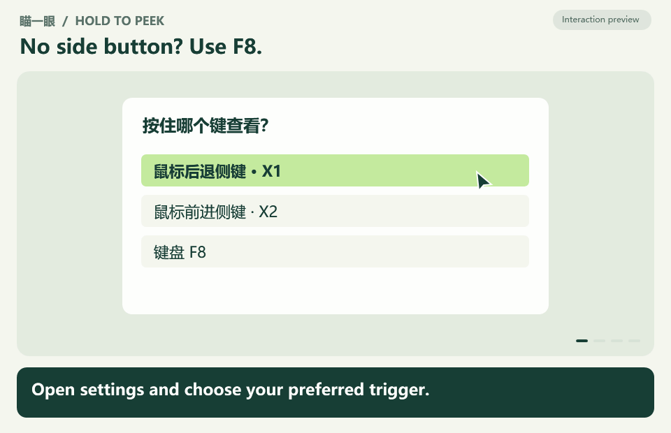
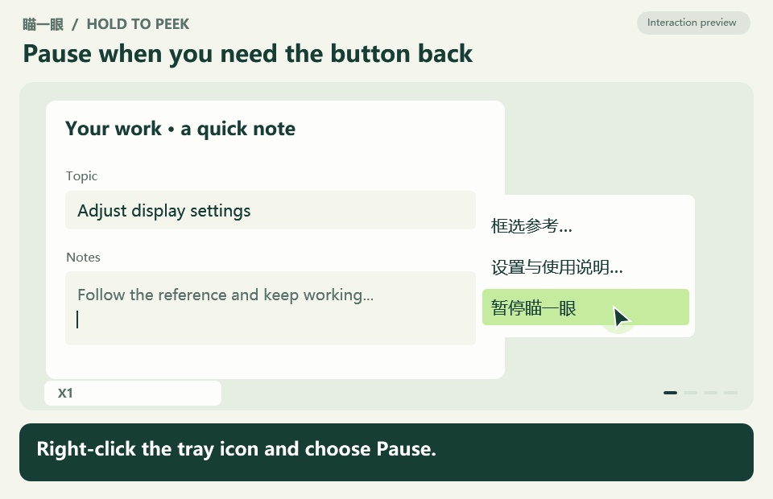

  

<a href="README.md">简体中文</a> · <b>English</b>

<b>Keep your reference close, even with just one screen.</b> Hold to peek. Release to work. Pick up at the same line next time.

  
  
  
  
  

  <a href="#the-few-lines-you-need-right-by-your-cursor">Use cases</a> ·
  <a href="#four-actions-then-back-to-work">How it works</a> ·
  <a href="https://github.com/JackieYangon/hold-to-peek/releases/download/v2.0.0/hold-to-peek-2.0.0-win-x64.zip">Download v2.0.0</a> ·
  <a href="https://github.com/JackieYangon/hold-to-peek/issues">Feedback</a>

> These captioned GIFs are interaction illustrations, not recordings. Some settings screens reflect 1.0.0; version 2.0.0 has separate shortcut and guide pages.

[Download Ubuntu X11 experimental](https://github.com/JackieYangon/hold-to-peek/releases/download/v2.0.0/hold-to-peek_2.0.0_all.deb) · **[Download the portable Windows x64 app](https://github.com/JackieYangon/hold-to-peek/releases/download/v2.0.0/hold-to-peek-2.0.0-win-x64.zip)** · [Read the v2.0.0 release notes](https://github.com/JackieYangon/hold-to-peek/releases/tag/v2.0.0)

## What is new in 2.0.0

- **Capture with F1.** Skip the trip to the tray menu.
- **Choose your shortcuts.** Record keyboard chords for capture and peek, or use a middle/side mouse button for peek.
- **Find settings easily.** Reference, shortcuts, startup, and the guide have their own pages.
- **Opt in when useful.** Login startup and higher CPU priority are disabled by default.
- **Try it on Ubuntu.** An X11/Xorg experimental package is available; Wayland is not supported yet.

## The few lines you need, right by your cursor

You read five steps in a tutorial, switch to Settings, and immediately need to check step two again. Back to the browser, then back to Settings. A small task turns into a lot of window switching.

Hold to Peek is designed to bring that reference closer: **hold a mouse side button to see it beside your cursor; release to keep working.**

| What you are doing | What you want close by |
| --- | --- |
| Following a Windows settings tutorial | A short list of instructions |
| Filling out a form from a chat message | Names, addresses, and requirements |
| Entering shipping or order details | The small section you keep checking |
| Adjusting application settings | Option names and their values |

Made for the moments when you have one laptop screen and need to read while you work.

## Four actions, then back to work

Get started in four actions:

1. **Capture.** Close settings and press F1, or choose “框选参考” (Capture reference) from the tray, then select the area you need.
2. **Hold.** Return to your work and hold the trigger. Your reference appears beside the cursor without taking focus from the active window.
3. **Scroll.** Move the highlight to mark your place. The window underneath stays still.
4. **Release.** The reference disappears. Hold again to return to the same line.

**One screenshot. One highlight. One button within reach.**

| Action | What it does |
| --- | --- |
| Back mouse button, X1 | The default hold-to-peek trigger |
| F1 | Default capture shortcut; customizable |
| Custom key or chord | Click to record in Shortcuts; peek also supports middle and side mouse buttons |
| Mouse wheel | Move the highlight by the configured line spacing |
| Shift + mouse wheel | Fine adjustment: one original-image pixel per notch |
| Esc | Cancel a capture or dismiss the current peek |
| Tray menu → “暂停” (Pause) | Restore the trigger button's normal function |

The highlight marks your reading position. It does not recognize text or identify the next instruction automatically. Capturing a new reference resets the position.

**On Windows, adjust spacing with your reference in view.** Reference settings lets you try the current screenshot and see the highlight change as you move the slider, without losing your reading position. If you start a capture from settings, Esc returns you there and keeps the existing reference.

## See it once, then try it

### Capture only what you need

Press F1 or start a capture from the tray, drag around your reference, and release. Esc or right-click cancels while keeping the previous reference.

### Keep your place as you read

Scroll while holding the trigger to move the highlight. Hold Shift as well to fine-tune its position by one original-image pixel per notch.

### Adjust spacing without guessing

On Windows, move the slider in Reference settings while looking at the current screenshot, then try a few lines. The preview keeps your original reading position intact. Save when it feels right.

### No side button? Use F8

Open “按键设置” (Shortcuts), click the peek binding, press F8 or your preferred chord, and save. Hold to view and release to hide, just like a mouse side button.

### Get your button back whenever you need it

Pause from the tray when you need the side button's normal forward or back action. Resume to return to the same reference and reading position.

## Get Hold to Peek

Current version: **2.0.0**. Choose your platform:

| Platform | Download and run |
| --- | --- |
| Windows x64 | [Download the portable ZIP](https://github.com/JackieYangon/hold-to-peek/releases/download/v2.0.0/hold-to-peek-2.0.0-win-x64.zip), extract, and run `HoldToPeek.exe`. The .NET runtime is included; no SDK needed. |
| Ubuntu 20.04+ · X11/Xorg experimental | [Download the .deb](https://github.com/JackieYangon/hold-to-peek/releases/download/v2.0.0/hold-to-peek_2.0.0_all.deb). See the [Ubuntu guide](docs/UBUNTU.md) for installation. **Wayland is unsupported; real Ubuntu desktop validation is pending.** |

Confirm your bindings in Shortcuts, save, then press F1 to capture. Closing settings leaves the app in the tray; choose Exit from the tray to quit.

[Release notes and SHA256 checksums](https://github.com/JackieYangon/hold-to-peek/releases/tag/v2.0.0) · [Changelog](docs/CHANGELOG.md)

If this is the tool you have been looking for, leave a **Star** or tell us in [Issues](https://github.com/JackieYangon/hold-to-peek/issues) which two windows you keep switching between.

## Before you use it

- **Your screenshot stays in local memory.** It is not uploaded or automatically saved to disk. The current screenshot and reading position remain available during the session and are cleared when you exit.
- **No mouse side buttons?** Record F8 or another keyboard shortcut: hold to view, release to hide.
- **Ubuntu requires X11/Xorg.** Keyboard and pointer input is temporarily grabbed during a peek and restored on release. Wayland is not supported.
- **Windows target: Windows 11 x64, regular desktop apps, and a single screen.** Windows 10, ARM64, multiple monitors, elevated windows, and games still need validation. Secure desktops and exclusive fullscreen apps are not guaranteed to work.
- **Windows uses a Simplified Chinese interface; Ubuntu provides bilingual labels.** This guide includes the relevant menu names.

[Development notes (Chinese)](docs/BUILD.md)

## License

This project is licensed under the [MIT License](LICENSE).
