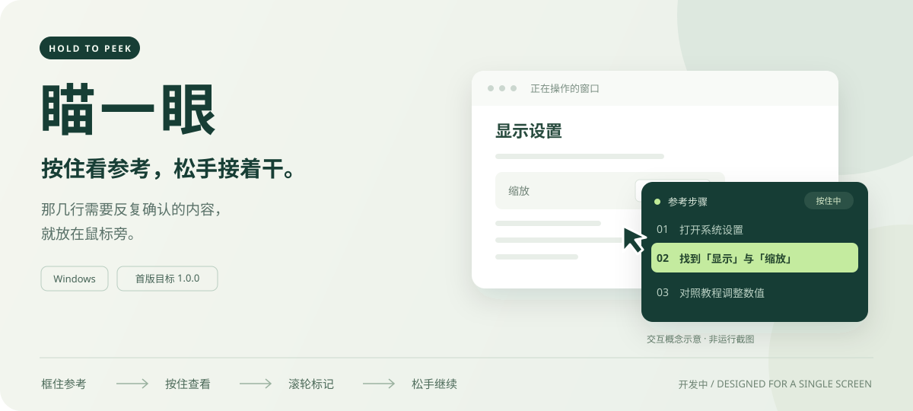

  

<b>简体中文</b> · <a href="README.en.md">English</a>

<b>只有一块屏幕，也能把参考放在手边。</b> 按住看一眼，松手接着干，再按还在刚才那一行。

<b>Windows</b> · <b>开发中</b> · 首版目标 <b>1.0.0</b>

  <a href="#需要的那几行就在鼠标旁">使用场景</a> ·
  <a href="#四个动作接着干">如何使用</a> ·
  <a href="#获取瞄一眼">获取应用</a> ·
  <a href="https://github.com/JackieYangon/hold-to-peek/issues">反馈与建议</a>

> **首版正在开发，暂未提供经过验证的下载包。** 上方为交互概念图，非软件运行截图。

## 需要的那几行，就在鼠标旁

教程里的五个步骤刚看完，切到设置窗口，第二步就想再确认一下。切回网页，看完再回来——一件小事，要来回好几趟。

「瞄一眼」想让参考离你近一点：**按住侧键，内容浮在鼠标旁；松开，继续手头的事。**

| 你正在做什么 | 留在手边的参考 |
| --- | --- |
| 跟着教程改 Windows 设置 | 网页里的几条操作步骤 |
| 照着聊天内容填表 | 姓名、地址和填写要求 |
| 录入快递或订单信息 | 需要反复核对的一小块内容 |
| 对照说明调应用参数 | 选项名称和对应数值 |

尤其适合只有一块笔记本屏幕、又需要一边看一边操作的时候。

## 四个动作，接着干

首版围绕这套流程设计：

1. **框住。** 从托盘菜单选择「框选参考」，留下需要看的那一块。
2. **按住。** 切回工作窗口，按住触发键，参考在鼠标旁出现，不抢走原窗口焦点。
3. **滚动。** 滚轮移动高亮线，标记读到的位置；底层页面不会跟着滚动。
4. **松手。** 参考收起，继续操作。再次按住，仍停在刚才那一行。

**一张截图，一条高亮线，一个顺手的触发键。**

| 操作 | 用途 |
| --- | --- |
| 鼠标后退侧键 X1 | 默认的按住触发键 |
| 鼠标前进侧键 X2 / 键盘 F8 | 在设置中选择一种替代方式 |
| 滚轮 | 按设置的行距移动高亮线 |
| Shift + 滚轮 | 微调高亮位置，每格移动 1 个原图像素 |
| Esc | 取消框选，或收起本次预览 |
| 托盘菜单「暂停」 | 暂停接管触发键，恢复按键原来的功能 |

高亮线标记的是阅读位置，不会自动识别文字或判断教程的“下一步骤”。换一张参考截图后，阅读位置重新开始。

## 获取瞄一眼

目前仍在开发与验证中，**暂未提供经过验证的程序或安装包**。可用版本准备好后，会在这里提供获取方式。

如果这正是你需要的小工具，欢迎点一个 **Star**，或到 [Issues](https://github.com/JackieYangon/hold-to-peek/issues) 说说你最常在哪两个窗口之间来回切换。

## 使用前了解一下

- **截图留在本机内存中。** 不上传，不自动保存到磁盘；退出程序后清除。本次运行内保留当前截图和阅读位置。
- **没有侧键也能用。** 在设置中选择 F8，按住查看、松开隐藏。
- **首轮面向 Windows 11 x64、普通桌面应用和单屏场景。** Windows 10、ARM64、多屏、管理员窗口及游戏场景仍待验证；不承诺安全桌面或独占全屏兼容。

[开发说明](docs/BUILD.md)
